<p align="center">
  
</p>

<p align="center"><b>A terminal-only password recovery and hash auditing tool for hashes you own or are authorized to test.</b><br />
It validates hash files, identifies plausible formats and drives Hashcat or John the Ripper Jumbo, entirely on your own machine.</p>

<p align="center">
  <a href="https://github.com/xzchick/hash-audit/actions/workflows/tests.yml"></a>
</p>
<p align="center">
  
  
  <br />
  
  
  
  
</p>

<p align="center">
  <a href="#install"><b>Install</b></a> ·
  <a href="#works-on">Compatibility</a> ·
  <a href="#formats">Formats</a> ·
  <a href="#extract">Extract</a> ·
  <a href="#demo">Demo</a> ·
  <a href="#usage">Recover</a> ·
  <a href="#safety">Safety</a> ·
  <a href="#troubleshooting">Troubleshooting</a>
</p>

> [!IMPORTANT]
> Use Hash Audit only with hashes you own or have explicit authorization to test. It performs offline recovery from local files. It has no online lookup, no account-login testing, no credential collection and no automatic wordlist downloads.

**Hashes are one-way.** Recovery works by hashing candidate passwords and looking for a match. A match doesn't prove the candidate is the only possible original input, and strong passwords, slow password hashing and large search spaces can make recovery impractical. There is no unlimited decryption mode and no recovery guarantee.

<a name="features"></a>




<a name="works-on"></a>


<p align="center">
  
  
  
</p>



<details>
<summary><b>Compatibility table as text</b></summary>

| Feature | macOS | Windows | Linux |
|---|:---:|:---:|:---:|
| Format detection and validation | ✅ | ✅ | ✅ |
| 23 registered hash formats | ✅ | ✅ | ✅ |
| Extract hashes from files (ZIP, RAR, KeePass) | ✅ | ✅ | ✅ |
| Dictionary (wordlist) recovery | ✅ | ✅ | ✅ |
| Hashcat masks and rule files | ✅ | ✅ | ✅ |
| John the Ripper Jumbo recovery | ✅ | ✅ | ✅ |
| Dry-run, time limits, clean stop | ✅ | ✅ | ✅ |
| Private per-run results | `0700`/`0600` | NTFS ACL `D:P` | `0700`/`0600` |
| Engine install route | Homebrew | `PATH` or WSL | `apt` / `dnf` |
| No Python dependencies | ✅ | ✅ | ✅ |
| Standalone bundle (draft v0.1.0) | arm64 | x86_64 | x86_64 |
| Python package (`pip install .`) | ✅ | ✅ | ✅ |
| Tested in CI on every push | ✅ | ✅ | ✅ |

Masks and rule files are a Hashcat feature; the John wrapper supports wordlists only. Both engines run on all three systems.

</details>

### Requirements

| | 🍎 macOS | 🪟 Windows | 🐧 Linux |
|---|---|---|---|
| **OS version** | macOS 13 Ventura or newer | Windows 10 22H2 or Windows 11 | A current x86_64 or arm64 distribution |
| **Python** | 3.10 or newer (not needed for the standalone bundle) | same | same |
| **Shell** | Terminal (zsh or bash) | PowerShell 5.1 or 7 | Any POSIX shell (sh, bash, zsh) |
| **Engine** | At least one of Hashcat or John Jumbo | same | same |
| **Hashcat GPU** | Metal, built in | NVIDIA or AMD driver, or CPU via OpenCL | NVIDIA or AMD driver, or CPU via OpenCL |
| **Python deps** | None | None | None |

> [!NOTE]
> Hash Audit doesn't install or bundle the recovery engines, GPU drivers or wordlists. You install an engine yourself, and the tool orchestrates it. `hashcat -I` shows whether Hashcat has a usable compute device.

<a name="install"></a>


You have two choices on every system: install the small Python package, or download a standalone bundle that needs no Python. Either way, install **at least one engine** (Hashcat and/or John Jumbo) separately.

### 🍎 macOS

With [Homebrew](https://brew.sh):

```sh
brew install python hashcat john-jumbo
```

<sub>These are the official formulas for <a href="https://formulae.brew.sh/formula/hashcat">Hashcat</a> and <a href="https://formulae.brew.sh/formula/john-jumbo">John Jumbo</a>. Installing both is optional; one engine is enough.</sub>

Then install Hash Audit from this folder:

```sh
git clone https://github.com/xzchick/hash-audit.git
cd hash-audit
python3 -m venv .venv
. .venv/bin/activate
python -m pip install .
hash-audit doctor
```

### 🪟 Windows

Install Python 3.10+ and an engine, then put `hashcat.exe` and/or John Jumbo's `john.exe` on your `PATH` (or use WSL):

```powershell
winget install --id Python.Python.3.12 -e
winget install --id hashcat.hashcat -e
```

<sub>For John Jumbo on Windows, download a build from <a href="https://www.openwall.com/john/">Openwall</a> and add its folder to <code>PATH</code>, or run Hash Audit inside WSL with the Linux steps.</sub>

Then install Hash Audit:

```powershell
git clone https://github.com/xzchick/hash-audit.git
cd hash-audit
py -3 -m venv .venv
.\.venv\Scripts\Activate.ps1
python -m pip install .
hash-audit doctor
```

> [!TIP]
> If PowerShell blocks the activation script, run `Set-ExecutionPolicy -Scope Process Bypass` for that window only, then activate again.

### 🐧 Linux

Install Python, Hashcat and (for more formats) John Jumbo:

| Distribution | Command |
|---|---|
| Ubuntu, Debian, Mint, Pop!_OS | `sudo apt update && sudo apt install -y python3 python3-venv hashcat` |
| Fedora, RHEL, AlmaLinux, Rocky | `sudo dnf install -y python3 hashcat` |
| Arch, Manjaro, EndeavourOS | `sudo pacman -S --needed python hashcat` |

<sub>A distribution package named <code>john</code> may not be <b>Jumbo</b>, which supports far more formats. When yours isn't Jumbo, build it from the <a href="https://www.openwall.com/john/">Openwall sources</a>. Distribution Hashcat packages can also lag upstream.</sub>

Then install Hash Audit:

```sh
git clone https://github.com/xzchick/hash-audit.git
cd hash-audit
python3 -m venv .venv
. .venv/bin/activate
python -m pip install .
hash-audit doctor
```

### Run without installing

From the project folder you can run the module directly, with no install step. Substitute it for `hash-audit` in any example:

```sh
python3 -m hash_audit --help
```

### Check your engines

`doctor` reports which engines are on your `PATH` and gives next steps:

```sh
hash-audit doctor
```

It also reminds you that Hashcat needs a working compute device (check with `hashcat -I`) and that John needs a Jumbo build (check with `john --list=formats`).

### Standalone bundles (coming with v0.1.0)

The v0.1.0 release will include bundles that need **no Python** — you still install an engine yourself. They're a draft. When published, download them from **Releases**:

| File | System |
|---|---|
| `hash-audit-v0.1.0-macos-arm64.tar.gz` | macOS on Apple Silicon |
| `hash-audit-v0.1.0-windows-x86_64.zip` | Windows on 64-bit x86 |
| `hash-audit-v0.1.0-linux-x86_64.tar.gz` | Linux on 64-bit x86 |
| `local_hash_audit-0.1.0-py3-none-any.whl` | Any OS with Python 3.10+ (`pip`) |
| `SHA256SUMS.txt` | Checksums for every file above |

<details>
<summary><b>Verify and run a bundle</b></summary>

**macOS and Linux**

```sh
shasum -a 256 -c SHA256SUMS.txt
tar -xzf hash-audit-v0.1.0-<os>-<arch>.tar.gz
cd hash-audit-v0.1.0-<os>-<arch>
sh ./install.sh
~/.local/bin/hash-audit doctor
```

**Windows PowerShell**

```powershell
Get-FileHash .\hash-audit-v0.1.0-windows-x86_64.zip -Algorithm SHA256
Get-Content .\SHA256SUMS.txt
Expand-Archive .\hash-audit-v0.1.0-windows-x86_64.zip -DestinationPath .
cd .\hash-audit-v0.1.0-windows-x86_64
powershell -ExecutionPolicy Bypass -File .\install.ps1
```

</details>

<a name="formats"></a>


Run `hash-audit formats` for the exact registry on your machine, or `hash-audit formats --json` for scripting. Detection reports **candidates**, not certainty: a bare hex digest can mean several algorithms, so pass an explicit `--format` even when only one candidate is listed.

| Format family | CLI format keys | Engines |
|---|---|---|
| Raw digests | `md5`, `sha1`, `sha256`, `sha512`, `ntlm` | Hashcat · John Jumbo |
| Legacy MySQL | `mysql323`, `mysql41` | Hashcat · John Jumbo |
| Portable phpass (older WordPress/phpBB) | `phpass` | Hashcat · John Jumbo |
| Modern WordPress bcrypt wrapper | `wordpress-bcrypt` | Hashcat (mode `35500`) |
| bcrypt | `bcrypt` | Hashcat · John Jumbo |
| Unix and Apache crypt | `md5crypt`, `apr1`, `sha256crypt`, `sha512crypt` | Hashcat · John Jumbo |
| Django PBKDF2-SHA256 | `django-pbkdf2-sha256` | Hashcat · John Jumbo |
| Digest of password + salt | `md5-pass-salt`, `sha1-pass-salt`, `sha256-pass-salt`, `sha512-pass-salt` | Hashcat |
| Digest of salt + password | `md5-salt-pass`, `sha1-salt-pass`, `sha256-salt-pass`, `sha512-salt-pass` | Hashcat |

That's 23 format keys. A few notes:

- **Salted digests** use `hex_digest:literal_salt`. The salt is 1–256 printable ASCII characters with no colon; spaces are significant and it's never read as hex. The two orders (password+salt vs salt+password) look identical, so you choose the right one.
- **MySQL** keys cover the legacy `mysql323` and `mysql41` schemes, not every modern MySQL auth plugin. A leading `*` on a 4.1/5 hash is handled for you.
- **NTLM** here means the stored NT hash, not a network challenge-response capture.
- **Modern WordPress** `$wp$2...` hashes use `wordpress-bcrypt` (Hashcat mode `35500`) and need a recent Hashcat; they are not plain bcrypt and must not be treated as such.
- **Django** input is `pbkdf2_sha256$iterations$salt$digest`. The Hashcat adapter (mode `10000`) accepts up to 999,999 iterations; use John for higher counts.

Format references: [Hashcat example hashes](https://hashcat.net/wiki/doku.php?id=example_hashes) and [John Jumbo format docs](https://github.com/openwall/john/tree/bleeding-jumbo/doc).

### Input rules

Pass a local ASCII text file with **one hash per line**, a single format per file. LF and CRLF both work and blank lines are ignored. Don't include usernames, emails, shadow-file records or CSV columns — split those out first. Limits: 16 MiB per file, 100,000 non-empty lines, 4,096 bytes per line.

<a name="extract"></a>


Many passwords aren't stored as a loose hash — they protect a file. `extract` pulls the password hash out of an encrypted file using John Jumbo's bundled `*2john` helpers, then hands it to `recover`. Nothing is decrypted and nothing leaves your machine; the helper only reads the file and prints its hash.

```sh
# detect the type, run the right helper, write a private hash
hash-audit extract report.zip
# then recover it with your own wordlist (John auto-detects the exact variant)
hash-audit recover hash-audit-extracts/extract-*/extracted.txt --format zip \
  --backend john --wordlist YOUR_WORDLIST
hash-audit show hash-audit-extracts/extract-*
```

| File type | `--type` | Helper | Recover with |
|---|---|---|---|
| ZIP archive (WinZip AES or PKZIP) | `zip` | `zip2john` | `--format zip --backend john` |
| RAR archive (RAR3 or RAR5) | `rar` | `rar2john` | `--format rar --backend john` |
| KeePass database (`.kdbx`) | `keepass` | `keepass2john` | `--format keepass --backend john` |

The type is detected from the file's extension and magic bytes; pass `--type` to be explicit. The extracted hash keeps a sanitized `label:` prefix that John needs to load it, with the original filename trimmed out. These file hashes are recovered through **John**, which auto-detects the exact variant; they are not Hashcat modes here. Use `--dry-run` to see the helper command without running it.

> [!NOTE]
> Encrypted Office documents (`office2john`) and SSH private keys (`ssh2john`) are next. Their helpers are Python and ship as Python 2 on older John builds such as 1.9.0, so they need a current John Jumbo whose helpers are Python 3.

<a name="demo"></a>


The example files are synthetic. `examples/md5.txt`, `examples/sha256.txt` and `examples/sha256-salted.txt` all use the password `AuditDemo42!`, and `examples/words.txt` contains it.

```sh
hash-audit formats
hash-audit detect examples/md5.txt
# preview the engine command without running anything or writing files
hash-audit recover examples/md5.txt --format md5 --backend hashcat \
  --wordlist examples/words.txt --output-dir demo-md5 --dry-run
# the real run, bounded to five minutes
hash-audit recover examples/md5.txt --format md5 --backend hashcat \
  --wordlist examples/words.txt --output-dir demo-md5 --max-seconds 300
hash-audit show demo-md5
```

Detection lists MD5 and NTLM for this 32-character digest, which is why you pass `--format md5` rather than trusting the appearance. The first real run can spend time compiling engine kernels.

<details>
<summary><b>John Jumbo, a salted digest and a PIN mask</b></summary>

John Jumbo instead of Hashcat:

```sh
hash-audit recover examples/sha256.txt --format sha256 --backend john \
  --wordlist examples/words.txt --output-dir demo-john --max-seconds 300
hash-audit show demo-john
```

A salted SHA-256 (digest of the password bytes followed by the literal salt `demo-salt`):

```sh
hash-audit recover examples/sha256-salted.txt --format sha256-pass-salt \
  --backend hashcat --wordlist examples/words.txt \
  --output-dir demo-salted --max-seconds 300
```

`examples/pin-md5.txt` hashes the toy PIN `0427`. A four-digit Hashcat mask covers all 10,000 candidates:

```sh
hash-audit recover examples/pin-md5.txt --format md5 --backend hashcat \
  --mask '?d?d?d?d' --output-dir demo-pin --max-seconds 300
```

Keep masks in quotes so your shell doesn't expand the `?`. Mask tokens: `?l ?u ?d ?s ?a ?h ?H ?b` and `??` for a literal question mark.

</details>

<a name="usage"></a>


Five commands, the same on every system:

| Command | What it does |
|---|---|
| `hash-audit formats` | Lists the registry and each format's engine mapping (`--json` for machine output) |
| `hash-audit detect FILE` | Shows candidate formats without printing the hashes (`--json` too) |
| `hash-audit extract FILE` | Pulls a password hash out of an encrypted file (see [Extract](#extract)) |
| `hash-audit doctor` | Finds installed engines and prints diagnostic hints |
| `hash-audit recover FILE …` | Runs a local wordlist or mask recovery |
| `hash-audit show RUN_DIR` | Displays recovered secrets from a previous run |

`recover` options:

| Option | Meaning |
|---|---|
| `--format KEY` | The hash format, or `auto` for an unambiguous `$`/`*` format (default `auto`) |
| `--backend hashcat`&nbsp;\|&nbsp;`john` | Which engine to drive (default `hashcat`) |
| `--wordlist PATH` | A candidate password list (required unless you pass `--mask`) |
| `--mask '?d?d…'` | An inline Hashcat mask (Hashcat only) |
| `--rules PATH` | A Hashcat rules file (needs `--wordlist`; Hashcat only) |
| `--output-dir PATH` | A new run directory; its parent must already exist |
| `--status-interval N` | Seconds between progress updates (default 5) |
| `--max-seconds N` | A wall-clock budget, including engine startup |
| `--dry-run` | Print the engine's argument list without writing files or running it |

`recover` needs either `--wordlist` or a Hashcat `--mask`. Press <kbd>Ctrl</kbd>+<kbd>C</kbd> to stop; a timeout or interruption shuts the engine down cleanly. A progress percentage reflects the candidate search, not the chance of recovering the password. Nothing is shown automatically after a run — use `hash-audit show` to read the results.

<a name="safety"></a>


- **No shell is involved.** Hashes are passed to the engine through a normalized local file, not on the command line. `--dry-run` shows you the exact argument list first.
- **Each run is isolated.** Every run gets its own directory with a private hash snapshot and a `run.json`. By default that's a unique folder under `hash-audit-runs/`; an explicit `--output-dir` must be new. The pot file is per-run, so results never leak in from a global cache.
- **Results are locked down.** On macOS and Linux the run directory is `0700` and files are `0600`. On Windows an explicit NTFS ACL (`D:P`) limits access to your user SID, `SYSTEM` and `Administrators`.
- **But not encrypted.** Recovered passwords sit in plain text in `recovered.pot` (and `recovered.txt` for Hashcat). Keep run folders out of shared drives and version control. Your OS, backups and engine caches may still retain data.

<a name="exit-codes"></a>


| Exit code | Meaning |
|:---:|---|
| `0` | The engine finished; this does **not** necessarily mean every password was recovered |
| `2` | Invalid input, a missing or unsupported engine, or a backend failure |
| `3` | Hashcat exhausted the selected candidates with hashes remaining |
| `124` | The `--max-seconds` time limit was reached |
| `130` | Interrupted with <kbd>Ctrl</kbd>+<kbd>C</kbd> |

John can exit `0` after exhausting its wordlist, so check its final progress and `hash-audit show` to see what was actually recovered.

<a name="troubleshooting"></a>


| Problem | Fix |
|---|---|
| `hashcat` or `john` not found | Install an engine, then run `hash-audit doctor`. On Windows, make sure the executable is on `PATH`. |
| Ambiguous format | Pass the algorithm the source system documents. Digest length alone can't prove it. |
| Hashcat: no devices or a compile error | Check `hashcat -I` and the run's diagnostics, then follow the driver docs. Try John Jumbo for a supported CPU format. |
| Unknown John option or format | Inspect `john --list=build-info` and `john --list=formats`; install a Jumbo build. |
| No match | Confirm the full hash and salt, the construction, the input encoding and your candidate list. Exhausting a list isn't proof the hash is invalid. |
| "Output directory already exists" | Choose a new name. `recover` never overwrites existing results. |
| PowerShell blocks activation | `Set-ExecutionPolicy -Scope Process Bypass`, then activate again. |

<a name="develop"></a>


Hash Audit has no third-party Python runtime dependencies. The test suite is the same on all three systems, and CI runs it on Ubuntu, Windows and macOS for every push.

```sh
python3 -m unittest discover -s tests -v
```

<details>
<summary><b>Build the release bundles locally</b></summary>

```sh
python -m pip install --upgrade pip build pyinstaller
python scripts/build_release_bundle.py
python scripts/smoke_test_release.py
```

To regenerate this README's artwork:

```sh
python scripts/render_readme_art.py
```

</details>

<a name="more"></a>


| Document | What's inside |
|---|---|
| [SUMMARY.md](SUMMARY.md) | A short overview of features and limits |
| [VALIDATION.md](VALIDATION.md) | What was tested, and what wasn't |
| [RELEASE_NOTES.md](RELEASE_NOTES.md) | v0.1.0 bundles and checksums |

### Validation at a glance

39 automated tests pass, covering format validation, ambiguous inputs, shell-metacharacter paths, private output permissions, timeout and interruption cleanup, terminal-escape handling and job integrity. Real John Jumbo recovery was verified for 10 formats with synthetic hashes. Hashcat command generation and result parsing were checked, but full Hashcat recovery wasn't run in the build environment because it exposed no usable compute device. See [VALIDATION.md](VALIDATION.md) for the details and the formats that weren't exercised in a real run.

<p align="center"><sub>MIT licensed. Hash Audit orchestrates Hashcat and John the Ripper Jumbo, which you install separately under their own licenses. Use it only with hashes you own or are authorized to test.</sub></p>
